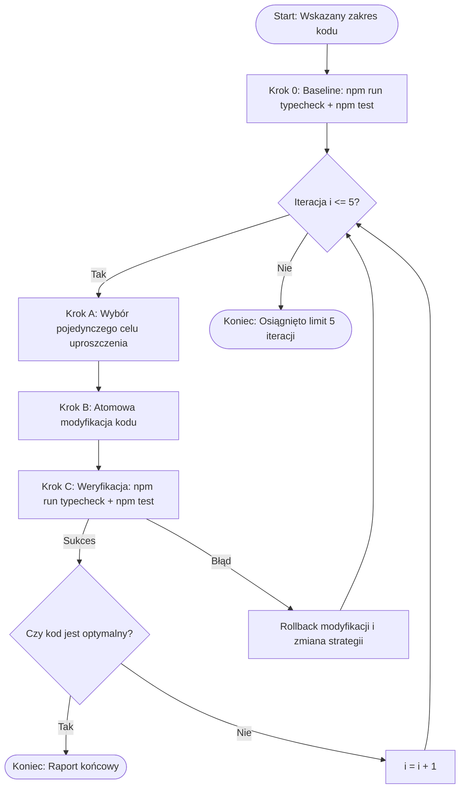

# Iterative Code Simplifier & Shrinker (`code-simplifier`)

Skill definiuje ścisłą, kontrolowaną procedurę iteracyjnego upraszczania, odchudzania oraz refaktoryzacji kodu w projekcie **usi-tree** (maksymalnie do 5 iteracji w pętli). Procedura ta gwarantuje zachowanie 100% poprawności funkcjonalnej, stabilności numerycznej geometrii, re-entrancy oraz czystości kodu zgodnie z kanonem TypeScript.

---

## 1. Trzy Filary Niezmienników (Invariant Guards) w `usi-tree`

Przed jakąkolwiek zmianą zidentyfikuj i zablokuj przed modyfikacją:

### 1.1. Geometria 3D & Obliczenia Numeryczne
- **Precyzja i tolerancje**: zachowaj stałe `EPSILON`, obwiednie korony `CrownEnvelope`, regułę rur da Vinci i ugięcia sprężyste beams (pliancy).
- **Topologia i bufory siatki**: nie zmieniaj struktury wierzchołków (`positions`, `normals`, `indices`, `groups`), orientacji trójkątów ani wyliczania `boundingBox`/`boundingSphere`.
- **Determinizm PRNG**: zachowaj kolejność losowań w strumieniu PRNG (`FastPrng`, `mulberry32`), aby dane ziarno dawało identyczne drzewo.

### 1.2. Re-entrancy i Bezpieczeństwo Współbieżne
- **Zakaz mutowalnego stanu statycznego**: `TreeGenerator` jest czystą fasadą. Wszelkie zmienne i bufory robocze muszą żyć w `GrowthContext` lub jako lokalne zmienne.
- **Weryfikacja wielowątkowa**: każda modyfikacja musi zachować zdawalność `src/__tests__/reentrancy.test.ts`.

### 1.3. Najlepsze Praktyki TypeScript i Architektura Modułów
- **Zero Runtime Dependencies**: rdzeń `usi-tree` nie może posiadać zewnętrznych zależności runtime (`three` jest opcjonalnym peerDependency).
- **Czystość typów domenowych**: wszystkie modele danych mieszkają w `src/core/types.ts` bez cyklicznych zależności.
- **Ścisłe typowanie**: bezwzględny zakaz wprowadzania nieuzasadnionych typów `any` lub rzutowań `as unknown as X`.
- **Czyste funkcje i wczesne powroty**: preferuj wczesne wyjścia (*early returns*) i likwiduj głębokie zagnieżdżenia.

---

## 2. Procedura Pętli Iteracyjnej (Max 5 Iteracji)

Wykonaj procedurę krok po kroku. Nigdy nie łącz wszystkich pomysłów w jeden wielki refaktor.

### Krok 0: Ustalenie Stanu Bazowego (Baseline)
1. Uruchom `npm run typecheck` i `npm test`.
2. Upewnij się, że stan bazowy przechodzi w 100%.

### Pętla (Iteracje 1 do 5):
- **Krok A**: Wybierz jeden konkretny blok kodu do uproszczenia (np. wydzielenie wspólnej formuły, usunięcie duplikacji, spłaszczenie zagnieżdżonych warunków).
- **Krok B**: Wprowadź minimalną, atomową zmianę (`replace_file_content`).
- **Krok C**: Uruchom weryfikację (`npm run typecheck && npm test`).
- Jeśli testy nie przechodzą: natychmiast wycofaj zmianę i obierz prostsze podejście.
